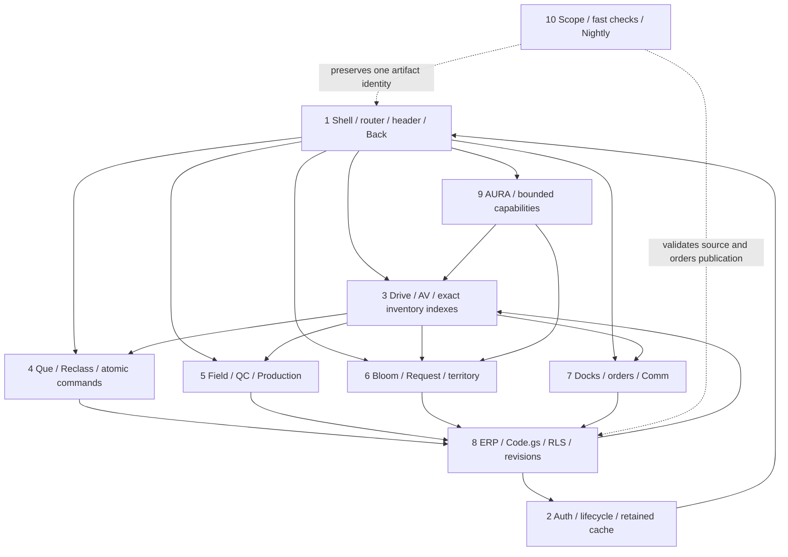

# AgData module dependency map

Static audit of **AgData v2.3.17**, source commit `efeed65b7bbc31e1eb2a53cf81d3a5111ac1286e`. This reference maps existing behavior; it does not change runtime permissions, recipients, UI, database objects, release ordering or paused automation.

## Source layout after v2.3.25 extraction

`index.html` owns DOM and ordered linked assets. `assets/app-runtime.js` owns the classic runtime and its existing public handlers; linked styles preserve the original cascade. Function links below now point to extracted sources. The v2.3.17 census and its metrics remain a historical snapshot, not counts of the current working tree. Functions moved into an asset are not counted as deleted functions.

## Scope and inventory

The [complete static inventory](agdata-static-inventory.json) records every file in the requested scope: `index.html`, 54 top-level `assets/*.js` files, `supabase/functions/app-api/index.ts`, 93 files under `supabase/migrations/`, `Code.gs`, and 478 files under `tests/` (including fixtures). That is **628 files / 27,543,652 bytes** inspected. Named callable locations total **29,719**, including nested and bundled library helpers; these are not 29,719 independent business features. Every named location has a file, line and suggested cluster; SQL declarations, literal app-api actions/RPCs and DOM IDs are also recorded where applicable.

The inventory uses static syntax traversal for HTML inline scripts/JS/TS/Apps Script and lexical SQL declarations. Its cluster hints use file/name patterns; the reviewed module tables below define authoritative ownership for ambiguous/shared helpers. Anonymous callbacks remain represented by their containing sources. Dynamic dispatch, dynamic SQL and later migration replacements require following the referenced implementation. Supporting source modules, styles and worker files were read where necessary to trace the requested files. Source line anchors are for the audit commit and may move later.

All tests were inventoried, not executed. The 1–3 Node files specified for each cluster are a **target under 10 seconds, unmeasured by this audit**; the per-row alternatives identify narrower coverage and are not instructions to run every listed file. A static Node contract is not evidence of rendered layout, production authorization, query latency, provider access or delivered email. The only delivery validation for this documentation/tooling change is `node scripts/run-tooling-release-checks.mjs` plus `git diff --check` (target under 15 seconds).

The inventory's hashes identify this audit snapshot. They are not release receipts and must never authorize skipped checks or require unchanged runtime hashes in subsequent feature releases. Update affected ownership and source evidence when contracts change. No Playwright, Docker/build, database suite or feature suite was run for this audit. Historical backfill and the 15-minute automation remain paused.

## Component dependency graph



Arrows describe dependencies and data flow, not permission inheritance. Every feature uses the shared router/header/Back lifecycle and same-account render generations; every mutation retains server authorization, idempotency and source identity. ERP publication rebuilds indexes coherently while app-owned tasks, notes and drafts survive refreshes.

## Cluster 1: Global App Shell, View Router and Navigation Stack

Owner: `agdata-app-shell-and-navigation`; partner: `agdata-zero-lockout-guard` for lifecycle/identity. No feature module owns an independent global Back implementation.

| Surface / exact DOM | Exact functions / sources | Upstream state and downstream dependencies | Backend boundary |
|---|---|---|---|
| Home, Menu, primary `#view-*` roots and `#view-wrapper` | [runDirectTrackedNavigation](../../assets/app-runtime.js#L15068), [showOnlyPrimaryView](../../assets/app-runtime.js#L15172), `syncCurrentViewBodyClass`, [switchView](../../assets/app-runtime.js#L76026), [renderHome](../../assets/app-runtime.js#L138545), [setHomeTab](../../assets/app-runtime.js#L125140) | `currentPrimaryViewId`, `body.dataset.currentView`, `current-view-*`, `activeHomeTab`, lifecycle `enterView`; one visible primary view, scroll and detail draft ownership. Hubs delegate to feature renderers rather than copying their records. | `canAccessView` / canonical permissions; Home sync actions are cluster 8. Routing itself performs no Apps Script mutation. |
| Navigation history, browser Back, breadcrumb drill state | [getCurrentVisibleViewId](../../assets/app-runtime.js#L75478), [pruneViewHistoryStack](../../assets/app-runtime.js#L75495), [pushViewHistoryEntry](../../assets/app-runtime.js#L75501), [peekPreviousViewHistoryEntry](../../assets/app-runtime.js#L75515), [fastBackToView](../../assets/app-runtime.js#L75546), [initializeNativeBackNavigation](../../assets/app-runtime.js#L75758), [goBackUniversal](../../assets/app-runtime.js#L76228) | `viewHistoryStack` bounded to 40, saved scroll, native guard, active feature drill (including `driveViewLevel`); Back unwinds open drawer/modal/interactive surface and feature drill before cross-view fallback. Breadcrumb helpers consume feature-owned drill state. | No independent persistence contract; do not replace server authorization with navigation visibility. |
| Header/search/status/Back: `#global-header-search-row`, `#global-header-inline-back`, mounted header search | [getGlobalHeaderChromeState](../../assets/app-runtime.js#L27241), [syncGlobalHeaderChrome](../../assets/app-runtime.js#L27279), [installAmazonHeaderChrome](../../assets/app-runtime.js#L27358), [updateGlobalBackButton](../../assets/app-runtime.js#L75819), [createAmazonInlineBackButton](../../assets/app-runtime.js#L26630), [createAmazonViewShell](../../assets/app-runtime.js#L26640) | `GLOBAL_HEADER_SEARCH_CONFIG`, visible view/body state, `cartPanelOpen`, Bloom overlays, productivity drill; preserve focused input node and cached chrome signature. Theme/status classes are shared presentation; dashboard sync metadata comes from cluster 8. | `assets/ops-precision-pilot.js` / `.css` apply chrome to account sessions; no new app-api or Code.gs ownership. |
| Modal/secondary controls: `[data-secondary-back]`, `.modal.show`, global Back popover | [buildFastInvokeAttrs](../../assets/app-runtime.js#L15782), [getVisibleSecondaryBack](../../assets/app-runtime.js#L76207), [syncGlobalModalBack](../../assets/app-runtime.js#L76219), [initializeModalBackNavigation](../../assets/app-runtime.js#L76222), `goBackUniversal` | Fast-invoke delegates hidden feature Back handlers; open-modal and active-view eligibility, ancestor visibility, inflight/draft state; popover promotion can escape normal header placement. Feature handlers must remain callable when local buttons are intentionally hidden. | Modal dismissal does not cancel an already committed atomic operation or erase pending retry identity. |
| Footer shortcuts, Menu and mobile hubs | [setMenuOpenState](../../assets/app-runtime.js#L59354), [toggleMenu](../../assets/app-runtime.js#L59372), [configureNavigationPreferences](../../assets/app-runtime.js#L75861), [updateFooterNavState](../../assets/app-runtime.js#L75901); `assets/navigation-preferences.js`: `normalizedShortcuts`, `allowed`, `permitted`, `adopt`, `call`; `assets/mobile-workspace.js`: `activationFor`, `GncMobileWorkspace.syncHub` | `GncNavigationPreferences.configure/refresh`; fixed Home/Menu/Comm, permitted configurable shortcuts and account-bound preferences. Menu/hub actions call `switchView`; preserve pointer/keyboard navigation and status badges. | app-api `navigation_preferences` and `user_access`; canonical access handlers/RLS. Imports/email remain cluster 8. |

```sh
node --test tests/inventory-drill-navigation.test.mjs tests/login-navigation-preferences.test.mjs tests/live-pilot.test.mjs
```

### Back visibility: evidence and limits

1. **Local Back suppression is deliberate and global.** [app-shell-style-13.css:2](../../assets/app-shell-style-13.css#L2) sets `[data-secondary-back]{display:none!important}`. [buildFastInvokeAttrs](../../assets/app-runtime.js#L15782) tags Back handlers with `data-secondary-back="true" aria-hidden="true"`. [ops-precision-pilot.css:1870](../../assets/ops-precision-pilot.css#L1870) also hides view-local `.amazon-inline-back`, `.back-btn` and `#po-management-back-btn`. A missing local button is expected only while the shared control remains usable.
2. **The actual central button is `#global-header-inline-back`.** [Header Back markup](../../index.html#L1022) puts this icon-only button inside `#global-header-search-row`, calls `goBackUniversal()` and supplies an accessible Back label. The always-hidden `#global-back-btn` rule at [app-shell-style-05.css:2016](../../assets/app-shell-style-05.css#L2016) targets a legacy lookup; that ID has no current markup. It is not proof the actual button is absent.
3. **Home collapses the parent, which child visibility cannot overcome.** [app-shell-style-05.css:1617](../../assets/app-shell-style-05.css#L1617) and the later [ops-precision-pilot.css:3535](../../assets/ops-precision-pilot.css#L3535) force Home's entire header/search row to `display:none!important`. `updateGlobalBackButton` uses `precisionShell || naturalShowBack`; `syncGlobalHeaderChrome` uses natural Back/Home-drill state. These competing Home rules cannot reveal a child of the collapsed normal header row. This is the source-confirmed cause of ordinary Home header Back suppression, including Home sub-surfaces that request Back.
4. **Non-Home explicitly reverses the collapse.** [app-shell-style-05.css:1621](../../assets/app-shell-style-05.css#L1621) and [ops-precision-pilot.css:3544](../../assets/ops-precision-pilot.css#L3544) force the non-Home row to flex; [1782](../../assets/ops-precision-pilot.css#L1782) forces the actual button, including its `.hidden` state, to inline-flex. `assets/ops-precision-pilot.js` adds its class and resynchronizes Back. Static evidence therefore does **not establish universal disappearance across non-Home views**. A false/stale body view, ancestor/overlay clipping or execution problem would require a rendered reproduction; none is asserted as observed here.
5. **Modal promotion is a separate path.** `syncGlobalModalBack` may promote the actual button into a manual popover/top layer; [app-shell-style-13.css:9](../../assets/app-shell-style-13.css#L9) supplies `:popover-open` positioning. `getVisibleSecondaryBack` filters open modal/active view, disabled/own-hidden/closed-details and hidden ancestors, but intentionally permits the local control's own CSS-hidden state. Preserving those handlers is essential to universal Back delegation.

**Conclusion:** the verified static mechanism is deliberate local-control suppression plus Home parent collapse and split Home visibility ownership. The reported all-view symptom is not fully explained by source evidence. No runtime fix or browser reproduction is claimed; a future fix should unify header/Back ownership while preserving drill, modal, keyboard/focus, auth and history behavior.

### v2.3.18 navigation maintenance

The preceding trace and inventory remain the v2.3.17 audit snapshot. The v2.3.18 frontend change makes `getGlobalBackState` / `applyGlobalBackState` the shared visibility owner for `updateGlobalBackButton`, `syncGlobalHeaderChrome` and `syncGlobalModalBack`. Normal navigation removes closed-popover mode and stale hidden/display/disabled state; chrome repair precedes search-focus, signature and deferred-work early exits. Primary view/body/visible DOM align before lifecycle callbacks. Back gives modal/wizard actions priority, then one feature drill step (including AV open-stock), delegated subqueue navigation, previous history and finally Home. Mobile Drive releases fixed filter spacers and additional command-to-filter margins. These changes have focused Node contracts; no browser reproduction or measured mobile layout is implied.

## Cluster 2: Auth, Session, Service Worker and Zero-Lockout Cache

The v2.3.24 server gate is `resolveZeroTrustRequestContext` in `supabase/functions/app-api/index.ts`: a verified session resolves an active profile and canonical `user_access_command_v1` permissions. Failed-login counters remain private behind the service-role-only `app_login_rate_limit_v1` RPC. The signed `apps_script_action` proxy derives its actor on the server; Code.gs verifies the envelope and canonical actor before dispatch.

The v2.3.25 [watchdog panel controller](../../assets/runtime-watchdog-panel.js) owns private account-scoped cached incidents/briefs and shares one pending incident read between badge and panel. View scope, auth identity, generation and mounted-host checks reject stale publication. Public handlers in `assets/app-runtime.js` preserve existing Manager and Back navigation; the telemetry sensor remains separate in `assets/runtime-watchdog.js`.

The v2.3.23 account contract is enforced by `isFullAppAdministrator`, `enforceCanonicalAccountPermissions` and `20261021035500_full_app_administrators_v1.sql`: Dylan, Megan and JD have all canonical operational flags; access management is exclusive to those canonical authenticated accounts. Request's protected N/A tuples are seeded by `20261021035641_protect_na_request_mappings_v1.sql`. Watchdog's panel/email Markdown is formatted by `_shared/runtime-watchdog-brief.ts`. These are source contracts, not production verification receipts.

Owner: `agdata-zero-lockout-guard`. Shared upstream boundary: `switchView`, `showOnlyPrimaryView`, `goBackUniversal`, `updateGlobalBackButton`, `viewHistoryStack`, account identity and render generations. Preserve header/search/modal ownership while changing feature-specific state.

| Feature | Exact frontend / source anchors | State / DOM / dependencies | Edge / RPC / tables / Apps Script |
|---|---|---|---|
| Native session | [app-runtime.js](../../assets/app-runtime.js)`getNativeAuthSession`; [app-runtime.js](../../assets/app-runtime.js)`loadNativeAuthProfile`; [app-runtime.js](../../assets/app-runtime.js)`refreshNativeRoleAndCapabilities` | nativeAuthSessionActive, nativeAuthSessionUserId/profile/token, recovery epoch; transient same-account refresh retains display/drafts. | app-api/index.ts:1385 resolveActiveSessionProfile; :3581 handleNativeSessionBridge; native_session_bridge; Auth sessions/profiles. |
| Identity and retained cache | [app-runtime.js](../../assets/app-runtime.js)`clearInMemorySessionIdentity`; [app-runtime.js](../../assets/app-runtime.js)`clearRoleScopedClientCaches`; [app-runtime.js](../../assets/app-runtime.js)`loadFromCache`; [app-runtime.js](../../assets/app-runtime.js)`saveToCache`; [app-runtime.js](../../assets/app-runtime.js)`persistUserScopedDatasetCache` | Actual identity clear destroys historical private UI; persisted dataset caches bind account, permission and revision; incomplete field/row coverage is explicit. | assets/bounded-snapshot-cache.js chunked IndexedDB generations; app_dataset_revisions; server RLS still applies. |
| Lifecycle / worker / resume | [assets/app-lifecycle.js:33](../../assets/app-lifecycle.js#L33) `resetSession`; [assets/app-lifecycle.js:41](../../assets/app-lifecycle.js#L41) `enterView`; [assets/app-lifecycle.js:49](../../assets/app-lifecycle.js#L49) `createScope`; [assets/app-lifecycle.js:20](../../assets/app-lifecycle.js#L20) `suspendNavigation`; [assets/app-lifecycle.js:25](../../assets/app-lifecycle.js#L25) `resume`; [app-runtime.js](../../assets/app-runtime.js)`getShellServiceWorkerRegistration`; [app-runtime.js](../../assets/app-runtime.js)`clearShellControllerCachesAndRegistrations` | Document/session/view AbortControllers; pageshow/PWA resume; purge only stale owned SW registrations/cache, never unrelated active work. | OneSignalSDKWorker.js, shell update/cache paths; worker readiness does not replace Auth. |
| Canonical access | [app-runtime.js](../../assets/app-runtime.js)`initializeAppAccessSnapshot`; [app-runtime.js](../../assets/app-runtime.js)`canonicalFeaturePermission`; [app-runtime.js](../../assets/app-runtime.js)`configureCanonicalUserAccess`; [assets/user-access-control.js:505](../../assets/user-access-control.js#L505) `configure`; [assets/user-access-control.js:263](../../assets/user-access-control.js#L263) `loadSelf`; [assets/user-access-control.js:464](../../assets/user-access-control.js#L464) `getEffectiveUserPermissions` | appAccessSnapshotState + productionLiveSyncReadAuthEpoch; verified flag denies differ from transient refresh; manager permission changes propagate current account only. | app-api user_access; _shared/canonical-user-access.ts resolveCanonicalUserAccess; user_access_command_v1, user_access_control, role_access_baselines, overrides. |
| SWR coordinator | [assets/live-sync-coordinator.js:28](../../assets/live-sync-coordinator.js#L28) `createCoordinator`; [assets/live-sync-coordinator.js:150](../../assets/live-sync-coordinator.js#L150) `retainDisplay`; [assets/live-sync-coordinator.js:166](../../assets/live-sync-coordinator.js#L166) `isDisplayRetainable`; [assets/live-sync-coordinator.js:194](../../assets/live-sync-coordinator.js#L194) `discardAppliedAfterDenial`; [app-runtime.js](../../assets/app-runtime.js)`getSupabaseReadIdentityScope`; [app-runtime.js](../../assets/app-runtime.js)`getProductionLiveSyncContext`; [app-runtime.js](../../assets/app-runtime.js)`getProductionLiveSyncCoordinator`; [app-runtime.js](../../assets/app-runtime.js)`resetProductionLiveSync` | Applied adapter identity/permission/source token; foreground/background cohorts and generation cancellation; published-readable does not imply mutationAllowed. | get_my_dataset_revisions_v1; app_sync_private.published_snapshot_read_proof and app_dataset_revisions. |

**1–3 existing pure local Node targets:**

```sh
node --test tests/release-app-lifecycle.test.mjs tests/live-sync-coordinator.test.mjs tests/live-sync-priority-cache.test.mjs
```

Target `< 10s`, unmeasured and not run. Select relevant subset; source/VM/injected transport tests do not prove production auth, browser layout, delivered reports or production query latency.

## Cluster 3: Drive, AV and Master DriveAround Indexer

Owner: `agdata-drive-and-av-specialist`. Shared upstream boundary: `switchView`, `showOnlyPrimaryView`, `goBackUniversal`, `updateGlobalBackButton`, `viewHistoryStack`, account identity and render generations. Preserve header/search/modal ownership while changing feature-specific state.

| Feature | Exact frontend / source anchors | State / DOM / dependencies | Edge / RPC / tables / Apps Script |
|---|---|---|---|
| Inventory Suggestion / Inv Consolidation | [app-runtime.js](../../assets/app-runtime.js)`renderInventoryConsolidationContent`; [app-runtime.js](../../assets/app-runtime.js)`getInventoryConsolidationValidDestinations`; [app-runtime.js](../../assets/app-runtime.js)`openInventoryConsolidationLocationMove` | `#view-inv-consolidation`, source/destination SalesYear, live current SalesYear, sixteen eligible sizes, tier-pure source and destination locations; Carry Over stays below current, Current stays exact current, Future stays exact source year. Cached rows remain displayable but stale options are re-guarded client-side. | app-api `handleInventoryConsolidationAction`; `get_consolidation_move_candidates_v1`, private atomic cache refresh, `inventory_consolidation_suggestions_v1`. No queue write occurs until explicit Send to Location Moves. |
| Master index / normalization | [app-runtime.js](../../assets/app-runtime.js)`getMasterInventoryExactKey`; [app-runtime.js](../../assets/app-runtime.js)`createMasterInventoryIndexMaps`; [app-runtime.js](../../assets/app-runtime.js)`rebuildMasterInventoryIndexes`; [app-runtime.js](../../assets/app-runtime.js)`processAndLoadData` | fullInventory, masterInventoryById/ExactKey/ItemCode; exact source/lot/item/location UID joins; dependent indexes rebuilt coherently. | [Code.gs:8098](../../Code.gs#L8098) `buildMasterPayload`; [Code.gs:7179](../../Code.gs#L7179) `buildMasterBulkSnapshotPayload_`; ph_master_inventory; app-api inventory_read master_page. |
| Six metrics | [app-runtime.js](../../assets/app-runtime.js)`getCardPtrAvailableValue`; [app-runtime.js](../../assets/app-runtime.js)`getCardLocationOnHandValue`; [app-runtime.js](../../assets/app-runtime.js)`getCardLocationOnHandServerAggregate`; [app-runtime.js](../../assets/app-runtime.js)`buildQueueInventoryMetricsHtml` | On Hand/Review/Available/Open Stock/Loc Photo Match/Loc On Hand. All-lot item+location sum requires matching aggregate receipt or complete authorized rows; unknown is not fake zero. | _shared/inventory-location-on-hand.ts; inventory_location_on_hand_read_v1; app_dataset_revisions + ph_master_inventory. |
| AV evidence / eligibility | [app-runtime.js](../../assets/app-runtime.js)`shouldIncludeMasterItemInAvOpenStock`; [app-runtime.js](../../assets/app-runtime.js)`shouldIncludeMasterItemInAvOpen`; [app-runtime.js](../../assets/app-runtime.js)`renderAV` | #view-av/#av-content/#av-search/#av-primary-tabs/#av-export-btn; avOpenInventory, selected name/size/season, reserve/customer indexes, AV/Hold evidence timestamps. | app-api av_read and inventory_read avOpen; ph_master_inventory, ph_reserves, AV notes/settings; can_access_av. |
| Drive tabs / drills | [app-runtime.js](../../assets/app-runtime.js)`renderDrive`; [app-runtime.js](../../assets/app-runtime.js)`backToDriveNames`; [app-runtime.js](../../assets/app-runtime.js)`backToDriveSizes`; [app-runtime.js](../../assets/app-runtime.js)`backToDriveSeasons`; [app-runtime.js](../../assets/app-runtime.js)`backToDriveBlocks`; [app-runtime.js](../../assets/app-runtime.js)`backToDriveLocations` | #view-drive/#drive-content/#drive-crumb/#drive-drill-tabs/#drive-mobile-mode; activeDriveMode/Tab, driveViewLevel and selected name/size/season/program/block/location. COMMONNAME/LOCATION/CARD/REPORTS. | inventory_read + settings; assets/inventory-list-contract.js; complete same-account snapshot, not fixed fixture/name-count gates. |
| Excel exports | [app-runtime.js](../../assets/app-runtime.js)`buildAVExportContext`; [app-runtime.js](../../assets/app-runtime.js)`exportCurrentAVToExcel`; [app-runtime.js](../../assets/app-runtime.js)`buildDriveCurrentExportContext`; [app-runtime.js](../../assets/app-runtime.js)`exportCurrentDriveModeToExcel` | Complete authorized filtered data, column selections and metadata; never only mounted/windowed cards. Export is not mutation. | Client Excel helpers use master projections; no report/recipient changes implied. |
| Detail / demand / photos | [app-runtime.js](../../assets/app-runtime.js)`renderDriveDetailOverviewFields`; [app-runtime.js](../../assets/app-runtime.js)`renderDriveDemandPanel`; [app-runtime.js](../../assets/app-runtime.js)`renderDriveAltLocPanel`; [app-runtime.js](../../assets/app-runtime.js)`renderAvDetailHero`; [assets/drive-demand-detail.js:35](../../assets/drive-demand-detail.js#L35) `selectRows` | activeItem, linked master UID/source/lot, reserve/customer context and photo/note freshness. Keep detail Back and modal controller hooks. | Bounded inventory/demand/reserve helpers; app-owned AV evidence survives ERP overlays; photo APIs are cross-cluster ownership. |

**1–3 existing pure local Node targets:**

```sh
node --test tests/inventory-card-location-on-hand.test.mjs tests/inventory-drill-navigation.test.mjs tests/drive-search-location.test.mjs
```

Target `< 10s`, unmeasured and not run. Select relevant subset; source/VM/injected transport tests do not prove production auth, browser layout, delivered reports or production query latency.

## Cluster 4: Operational Queues and Reclass Item Inquiry

Owner: `agdata-queue-and-reclass-specialist`. Shared upstream boundary: `switchView`, `showOnlyPrimaryView`, `goBackUniversal`, `updateGlobalBackButton`, `viewHistoryStack`, account identity and render generations. Preserve header/search/modal ownership while changing feature-specific state.

| Feature | Exact frontend / source anchors | State / DOM / dependencies | Edge / RPC / tables / Apps Script |
|---|---|---|---|
| Physical Suspend rows / latest file | [app-runtime.js](../../assets/app-runtime.js)`getCurrentSuspendTagSourceFreshness`; [app-runtime.js](../../assets/app-runtime.js)`getLatestSocImportFileWatermark`; [app-runtime.js](../../assets/app-runtime.js)`getLatestSocSuspendTagSourceRows`; [app-runtime.js](../../assets/app-runtime.js)`buildSuspendTagRenderPlan` | suspendTagRawSourceRows, socRawSourceRows, suspendTagInventory and freshness; one physical source UID per card. SOC/source watermark data must agree. | app-api/index.ts:865 handleDatasetRead + :5473 suspend_tag route; app-api/suspend-tag-read.ts:4 suspendTagRowsFromResult, :15 suspendSourceFreshnessQuery; ph_soc_master/workflows/approvals. |
| Filters / natural sort / Request | [app-runtime.js](../../assets/app-runtime.js)`compareRequestSuspendTagRows`; [app-runtime.js](../../assets/app-runtime.js)`sortRequestSuspendTagRows`; [app-runtime.js](../../assets/app-runtime.js)`renderRequestSuspendTagFilters`; [app-runtime.js](../../assets/app-runtime.js)`renderRequest` | #view-request/#request-content, activeReqTab, assignment/name/size/location filters; natural location followed by stable row identity. Equal tuples must not collapse physical lines. | dataset_read request_queue/suspend_tag; protected operational requests and canonical can_access_que. |
| Lazy page / shared cards | [app-runtime.js](../../assets/app-runtime.js)`createSuspendTagPageRenderRow`; [app-runtime.js](../../assets/app-runtime.js)`renderSuspendTagPagedCards`; [app-runtime.js](../../assets/app-runtime.js)`generateCard`; [app-runtime.js](../../assets/app-runtime.js)`buildSharedInventoryCardLayout` | Page markup cache + source/auth/revision/render tokens; DOM no-op must not clear populated row cache. Shared metrics and completion state affect other queues. | assets/queue-completion-state.js and queue-inventory-hydration.js; physical source UID differs from master UID. |
| Exact master hydration | [app-runtime.js](../../assets/app-runtime.js)`getQueueCardInventoryAuthorizationContext`; [app-runtime.js](../../assets/app-runtime.js)`loadQueueCardInventoryBatch`; [app-runtime.js](../../assets/app-runtime.js)`scheduleSuspendTagReclassLoads`; [app-runtime.js](../../assets/app-runtime.js)`getOperationalCardInventoryRow`; [assets/queue-inventory-hydration.js:18](../../assets/queue-inventory-hydration.js#L18) `identity`; [assets/queue-inventory-hydration.js:28](../../assets/queue-inventory-hydration.js#L28) `matches`; [assets/queue-inventory-hydration.js:41](../../assets/queue-inventory-hydration.js#L41) `createIndex`; [assets/queue-inventory-hydration.js:71](../../assets/queue-inventory-hydration.js#L71) `createHydrator` | Pending/ready/ambiguous row state binds account, permission and source revision. Exact data may hydrate after paint without suppressing cached authorized actions. | inventory_read master_identity_batch; inventory_master_identity_batch_read_v1; exact UID or qualified tuple resolver. |
| Reclass draft | [app-runtime.js](../../assets/app-runtime.js)`openArgosInventoryTransactionModal`; [app-runtime.js](../../assets/app-runtime.js)`getReadableCachedArgosItemInquiryGroup`; [app-runtime.js](../../assets/app-runtime.js)`handleArgosReclassFieldInput`; [app-runtime.js](../../assets/app-runtime.js)`collectArgosReclassInventoryFieldEdits` | #argos-inventory-transaction-modal/form/#argos-reclass-item-inquiry/#argos-inventory-transaction-apply; argosReclassRowEditorEntries/MultiActionState; dirty quantities/Hold/Stop/notes survive late hydration. | drive_reclass_inquiry; services/reclassEditableFields.ts/reclassLiveEdits.ts; shared modal/back hooks, no user-draft reset on cache refresh. |
| Atomic submit / retries / receipts | [app-runtime.js](../../assets/app-runtime.js)`submitArgosInventoryTransaction`; [app-runtime.js](../../assets/app-runtime.js)`applyArgosInventoryTransactionReturnedRow`; [app-runtime.js](../../assets/app-runtime.js)`publishArgosInventoryTransactionReturnedRows`; [app-runtime.js](../../assets/app-runtime.js)`persistPendingArgosInventoryReclassMove` | Inflight controls + original actor + idempotency command + pending retry + exact receipt memo; optional cache revision, server exact source CAS; one coherent index rebuild before propagation. | app-api inventory_reclass_move / handleDriveReclassAction; _shared/production-workflow.ts; services/reclassMove.ts/reclassMoves.ts/reclassReceipt.ts; apply_inventory_reclass_moves_with_delivery_v1 / enqueue_drive_reclass_inquiry_v7. |
| Completion / close / approval | supabase/functions/_shared/suspend-tag.ts handleSuspendTag / verifySuspendTagSession; [app-runtime.js](../../assets/app-runtime.js)`renderRequest` | Native active session + editor/approver + source/workflow version; complete/close/decision/delivery remain separate states, no browser raw SOC writes. | suspend_tag_command_v1; suspend_tag_private.command/workflows/approvals; ph_request_delivery_outbox. |
| HTML/PDF reports / recipient policy | [Code.gs:14718](../../Code.gs#L14718) `getReclassInquiryEmailRecipients_`; [Code.gs:16365](../../Code.gs#L16365) `buildReclassInquiryReportModel_`; [Code.gs:16523](../../Code.gs#L16523) `buildReclassInquiryReportHtml_`; [Code.gs:16730](../../Code.gs#L16730) `buildReclassInquiryCompactReportHtml_`; [Code.gs:20066](../../Code.gs#L20066) `handleSignedReclassInquiryDelivery_`; [Code.gs:21910](../../Code.gs#L21910) `handleSignedInventoryReclassMoveDelivery_` | Frozen receipt-backed full HTML/PDF report + signed durable outbox handoff. Queued is not delivered; verify actual channel receipts. | private.reclass_delivery_recipients_v1 / get_reclass_delivery_recipients_v1: active confirmed Dylan + Megan + Sharon + submitter, deduplicated. JD receives own submissions; JD/Sunday are not extra fixed recipients. |

**1–3 existing pure local Node targets:**

```sh
node --test tests/reclass-zero-lockout.test.mjs tests/suspend-tag-dataset.test.mjs tests/reclass-recipient-policy.test.mjs
```

Target `< 10s`, unmeasured and not run. Select relevant subset; source/VM/injected transport tests do not prove production auth, browser layout, delivered reports or production query latency.

## Cluster 5: Field Operations, QC and Production

Owner: `agdata-field-ops-and-qc`. Shared upstream boundary: `switchView`, `showOnlyPrimaryView`, `goBackUniversal`, `updateGlobalBackButton`, `viewHistoryStack`, account identity and render generations. Preserve header/search/modal ownership while changing feature-specific state.

| Module / DOM | Exact frontend entrypoints and source | State/index and upstream/downstream dependencies | Backend/data/delivery contracts | Focused Node target |
|---|---|---|---|---|
| Manager / QC / Production hubs: `#managers-content`, `#view-qc`, `#view-production` | [renderManagers](../../assets/app-runtime.js#L138327), [renderQcHub](../../assets/app-runtime.js#L68734), [renderProductionHub](../../assets/app-runtime.js#L68746) | `activeHomeTab`, `getManagersToolAccess`, `getRoleAccessState`, `GncMobileWorkspace.syncHub`, `setHubButtonVisibility`; delegates to Drive/Que/Grower/Office, does not own separate copies of those records | `manager_season_settings` → `handleManagerSeasonSettings`; canonical manager access; `ph_app_settings` settings feed reports and current season | `tests/manager-season-settings.test.mjs` |
| Eval Work Que folder and pictures/specs detail; `#eval-work-spec`, `#eval-work-loc-match`, `#eval-work-av-note`, setup modal | [loadEvalWorkAssignments](../../assets/app-runtime.js#L30467), [renderEvalWorkQueue](../../assets/app-runtime.js#L31223), [openEvalWorkDetail](../../assets/app-runtime.js#L31271), [saveEvalWorkDraft](../../assets/app-runtime.js#L31364), [submitEvalWork](../../assets/app-runtime.js#L31427), [openEvalWorkSetupFromReclass](../../assets/app-runtime.js#L31630) | `evalWorkRows`, `activeEvalWorkDetailId`, `evalWorkDetailGeneration`, `evalWorkActiveOriginUid`, offline draft store, `data.master`, `activeReqTab='eval-work'`; exact-origin inquiry rows and local drafts, queue render scheduler, photo upload/history | `eval_work`: `get_eval_work_review_setup_v1`, `create_eval_work_multi_v1`, legacy `create_eval_work_legacy_sep09_v1`, `reassign_eval_work_v2`, `save_eval_work_v2`, `submit_eval_work_v2` (legacy v1 variants remain). `ph_eval_work`, origin rows, audit/events and delivery outbox. Modern create resolves source AssignedTo atomically before freezing recipients; creator retry returns existing work. Apps Script signed Eval delivery creates HTML/PDF | `tests/eval-work.test.mjs` |
| Eval Reports1/2, assigned item/default owner, season priority; `#manager-eval-report-records`, `#manager-eval-report-2-browse-region`, `#manager-eval-report-2-selection-tray` | [renderManagerEvalReportsPanel](../../assets/app-runtime.js#L129008), [loadManagerEvalReports2](../../assets/app-runtime.js#L129173), [buildManagerEvalReport2IndexAsync](../../assets/app-runtime.js#L129321), [renderManagerEvalReports2Panel](../../assets/app-runtime.js#L131236), [renderManagerAssignedItemsPreviewTable](../../assets/app-runtime.js#L133638), [renderManagerSeasonPriorityPanel](../../assets/app-runtime.js#L135711); `assets/eval-reports-engine.js` `classifyRows`, `classifyScriptCompatibleRowsAsync`, `buildAuthoritativeAssignmentModelAsync`, `buildItemInquiryModel`; report-page source components/services | `managerEvalReport2Index`, view/report/filter/selected source identities, warehouse assignment/default-owner indexes, season settings. `assets/report-pages-live.js:createController` owns page metadata/sourceRevision and mounted views; metadata cannot replace already displayed rows. Data scope includes `ph_inventory_row_assignments`, `ph_itemcode_default_owners`, master and warehouse sources | `report_read_v2` → `handleManagerReportReadAction`, `manager_report_read_v2`; `eval_work/report_page` → `list_eval_report2_itemcodes_v1`; canonical `can_access_eval_reports_2` versus manager surface checks remain separate. Manager settings feed engine classifications | `tests/eval-reports-engine.test.mjs` |
| Bunch Notes, work cards and recount; `#bunch-note-content`, `[data-bn-picker-results]`, `[data-bn-cards]` | `assets/bunch-note.js`: `BunchNote.open`, `back`, `saveDraft`, `preparePdf`; card picker and action editor, `requiredBunchRecipientIds`. Source `components/bunch-notes/` models/CardBoard/StructuredBunchNote; `assets/bunch-queue-shell.js`: `render`, `openDetail`, `closeDetail`, `stage`, `commit`; `components/bunch-queue/`, `services/bunchQueue.ts` | Bunch `state.account`, `epoch`, drafts, per-location physical cards/source snapshots, owner IDs, board state/scrolls and command Map; queue's scoped client and visible `view-detail`. Distinct create/assigned/review/recount transitions; preserve typed quantities and overwintering notes | `bunch_note` → `bunch_note_command_v1`; `bunch_note_workflow` → `bunch_note_workflow_command_v1` (`queue`, `list_discrepancies`, `complete_card`, `assign_counter`, `complete_recount`). Required recipients: Dylan + Megan + Sharon + location/card owners; selected active mapped additions retained. `_shared/bunch-note-pdf-delivery.ts` → signed Apps Script PDF handling; no synchronous polling gate | `tests/bunch-note-card-model.test.mjs` |
| Location Moves / Recount / moves planning; `#manager-moves-content`, Request location-work queue/detail | [loadLocationWorkJobs](../../assets/app-runtime.js#L111210), [openLocationWorkJob](../../assets/app-runtime.js#L111235), [renderLocationWorkQueue](../../assets/app-runtime.js#L111277), [renderLocationWorkDetail](../../assets/app-runtime.js#L111291), [resolveLocationWorkLine](../../assets/app-runtime.js#L111328), [renderManagerMovesPanel](../../assets/app-runtime.js#L137786) | `locationWorkRows`, detail job/line identities, Request folder/tab selection, manager move source/destination and reviewer state, current inventory CAS. Natural `locationcode` ordering; preserving rows is distinct from grouping display | `location_work` → create/update/resolve/cancel/retry RPCs; `ph_location_work_jobs`, `ph_location_work_lines`, `ph_location_work_assignments`, `ph_location_work_delivery_events`, `ph_location_work_audit`. `Code.gs` signed worksheet/PDF email path; protected app-owned tasks survive ERP imports | `tests/location-work.test.mjs` |
| Shear List / per-location inquiries / approval / Move Test; `#shear-list-content`, `#shear-list-modal-rows` | [loadShearListData](../../assets/app-runtime.js#L74226), [renderShearList](../../assets/app-runtime.js#L75280), [openShearListModal](../../assets/app-runtime.js#L142855), [submitShearList](../../assets/app-runtime.js#L142878), [completeShearListRow](../../assets/app-runtime.js#L75355), [completeShearLocationInquiry](../../assets/app-runtime.js#L75240), [renderShearMoveTestRequestQueue](../../assets/app-runtime.js#L73536), [renderShearApprovalDetail](../../assets/app-runtime.js#L127161) | `shearListState.rows`, tabs/drill/Drive filter, master/Request stock and reserve decision inputs. Preserve lot/source UID, percent/type/instructions, row completion and approval independently | `shear_location_work` → `create_shear_location_inquiries_v1`; `ph_shear_location_inquiries`, `ph_shear_location_items`, `ph_shear_location_rows`, `ph_shear_list`; `handleSignedShearLocationDelivery_` and completion report/email. No invented type/grade mappings | `tests/shear-location-inquiry.test.mjs` |
| Production workflow / inventory history / field counting / 84RD; `#production-workflow-page-content`, `#production-inventory-counting-content`, `#production-inventory-84rd-content` | [loadProductionWorkflowRows](../../assets/app-runtime.js#L67954), [renderProductionWorkflowPanel](../../assets/app-runtime.js#L68552), [completeProductionWorkflowRow](../../assets/app-runtime.js#L68495), [createFieldCountingTransport](../../assets/app-runtime.js#L68867), [ensureFieldCountingIsland](../../assets/app-runtime.js#L68911), [renderProductionInventoryCountingContent](../../assets/app-runtime.js#L70706), [renderProductionInventory84Content](../../assets/app-runtime.js#L70712); source `components/field-counting/{model,contract,FieldCountingView,mount}`, `services/fieldCounting.ts` → compiled `assets/field-counting.js` | `productionWorkflowState`, current tab/filter, stable row/source IDs; `createFieldCountingTransport` binds active owner/read generation and calls dedicated bridge. Workflow stage/publish semantics preserve stock/evidence; no cached display writes directly to unrelated master rows | `production_workflow` → `production_workflow_command_v1`; `inventory_transaction_history` → `inventory_transaction_history_v1`; `ph_production_workflow_rows`, transactions, `ph_bunch_counts`, `ph_master_inventory`. Mutation-side authorization and revisions stay server checked | `tests/production-workflow.test.mjs` |
| Production Schedule workbook; `#manager-production-schedule-root`, `[data-ps-search]`, `[data-ps-detail-body]` | `GncProductionSchedule.mount` / `unmount`, `services/productionScheduleClient.js:createProductionScheduleClient`, `productionScheduleSheets.js:getScheduleCard/getScheduleRowDetails`; `components/managers/ProductionSchedule/` produces `assets/production-schedule.js` | Manager tool permission, seven-sheet snapshot, sheet/row physical positions, duplicated/blank source headers retained, client query/detail cursor and import status. Unmount on manager-tab change; no global nav replacement | `production_schedule` → read metadata/status/start/fail-import RPCs, `production_schedule_rows`, `production_schedule_snapshots`; signed `Code.gs` acceptance → resumable `runProductionScheduleImportChunk_`. Preserve sparse row column positions | `tests/production-schedule-client.test.mjs` |
| Grower scout, disease/pest, take-back, block clearing, flags and overwintering | [renderGrowerScout](../../assets/app-runtime.js#L126472), [renderGrowerScoutSummaryPanel](../../assets/app-runtime.js#L126445), [renderManagerBlockClearingPanel](../../assets/app-runtime.js#L134501); `renderManagerBlockClearingPanel`, `renderManagerBlockClearingPhysicalRows`, `renderManagerBlockClearingInstructionsPanel` | Existing grower inventory/scout/report/status and manager selected physical-row scopes; Hold/Stop/flag grades and app notes are data rules, not shell labels. Keep selected-season and assigned-user evidence while import refreshes | Existing `ph_grower_scout_reports`, master/evidence fields, approval/workflow and outbox contracts. Do not infer new flag grades or erase overwintering notes from absent import values | `tests/manager-season-priority-protected.test.mjs` |

Field delivery anchors: [handleSignedEvalWorkDelivery_](../../Code.gs#L20392), [handleSignedShearLocationDelivery_](../../Code.gs#L20547), [handleSignedLocationWorkDelivery_](../../Code.gs#L20691), [handleSignedBunchNoteDelivery_](../../Code.gs#L21526), [runProductionScheduleImportChunk_](../../Code.gs#L774). API branches: [handleEvalWorkAction](../../supabase/functions/app-api/index.ts#L2706), [handleManagerReportReadAction](../../supabase/functions/app-api/index.ts#L2993), [handleShearLocationAction](../../supabase/functions/app-api/index.ts#L2042), [handleLocationWorkAction](../../supabase/functions/app-api/index.ts#L2225), [handleProductionScheduleAction](../../supabase/functions/app-api/index.ts#L1153). Bunch recipient proof: [requiredBunchRecipientIds](../../assets/bunch-note.js#L132).

**Default scoped Node command (target under 10 seconds, unmeasured):**

```sh
node --test tests/eval-reports-engine.test.mjs tests/bunch-note-card-model.test.mjs tests/production-schedule-client.test.mjs
```

Select the affected 1–3 files; per-row alternatives above describe narrower coverage, not an aggregate suite.

## Cluster 6: Bloom, Sales Requests and Territory Email

Owner: `agdata-bloom-and-request-specialist`. Shared upstream boundary: `switchView`, `showOnlyPrimaryView`, `goBackUniversal`, `updateGlobalBackButton`, `viewHistoryStack`, account identity and render generations. Preserve header/search/modal ownership while changing feature-specific state.

| Module / DOM | Exact frontend entrypoints/source | State/index and shared dependencies | Backend/data/email contracts | Focused Node target |
|---|---|---|---|---|
| Bloom Selected Rows tray / nine actions; `#bloom-picker-tray`, `#bloom-picker-clear`, `#bloom-picker-list-container` | [renderBloomPickerTrayRows](../../assets/app-runtime.js#L92541), [clearBloomPickerSelection](../../assets/app-runtime.js#L99097), [openBloomPickerModal](../../assets/app-runtime.js#L52241), [submitBloomPickerOrder](../../assets/app-runtime.js#L52283), [openBloomActionRowFormModal](../../assets/app-runtime.js#L96042), [submitBloomActionRowForm](../../assets/app-runtime.js#L98468) | `cartPanelOpen`, cart selected row IDs and draft quantities; master metrics/location totals, photo indexes and tray swipe delegation; shared action bar/modal/nav ownership. Preserve Assign, Eval Work, Submit QC, Request, Location Move, Flyer, Take Back, 2nd Cut, Shear | Existing workflow-specific Request/Eval/Location/Shear/Reclass actions; no generic action can bypass its server permission or receipt. Metric calculations share inventory helpers, not stored guessed totals | `tests/bloom-picker-metrics.test.mjs` |
| Request wizard / Rep→Customer→Consignee→Folder→ITEM1OFN→Email; `#request-rep-modal`, `#step-1-rep`, `#step-1.5-folder`, `#request-qty-scroll-body`, `#request-submit-btn` | [openRequestModal](../../assets/app-runtime.js#L142986), [selectRepForRequest](../../assets/app-runtime.js#L143548), [loadRequestModalCustomerOptionsForRep](../../assets/app-runtime.js#L50702), `getRequestUniversalCustomerOptions`, `fetchRequestUniversalCustomerOptions`, [renderExistingRequestFolderPicker](../../assets/app-runtime.js#L143458), [renderRequestQtyStepCurrentItem](../../assets/app-runtime.js#L143897), [submitRequestWithQtys](../../assets/app-runtime.js#L144364), [finalizeRequestAction](../../assets/app-runtime.js#L145163) | `tempSelectedReqRep`, `tempReqCust`, `tempReqFolder`, `tempRequestCustomerSelectedContext`, customer selection keys, qty-step drafts, mapping generation/RPC cache; prefetched local directories and owner-qualified fallback mapping. JD's universal directory cache is fenced by the same-account owner signature. Preserve locked Rep and selected-source context separately from actor | `customer-rep-map` → `handleCustomerRepMappingAction`; `request_jd_customer_directory_v1`; `sales_private.is_jd_universal_request_tuple_v1`; `ph_customer_consignee_sales_reps`; `request_recipient_directory` active directory. Final guarded `db` write boundary resolves selected Rep/customer/consignee and forbids internal-row spoofing | `tests/request-mapping-reader.test.mjs` |
| Durable Request submit/retry/conflicts | [getRequestSubmissionController](../../assets/app-runtime.js#L22990), [performRequestSubmission](../../assets/app-runtime.js#L23061), [flushRequestOutbox](../../assets/app-runtime.js#L23144), [restoreRequestSubmissionForm](../../assets/app-runtime.js#L22914); `assets/request-submission.js` `createController`, `validateAcknowledgment`, `resolveCustomerMappingPayload`, `saveRequestWorkWithReconciliation`, `mergeRequestWorkAcknowledgment` | owner key, `requestSubmissionGeneration`, immutable batch identity, IndexedDB entries/blob store, selected physical source rows, field draft versions. Only validated acknowledgment clears owned selection/blobs; account change or mapping conflict cannot silently resubmit a different command | Request creation → protected `ph_active_request`; outbox event/worker/signed Code.gs email. Data acknowledgment and email dispatch are distinct; failure retains retry/review state | `tests/request-submission-durability.test.mjs` |
| Territory email picker / crop update / shift / purposes; `#request-email-chain-panel` | [renderRequestEmailChainPanel](../../assets/app-runtime.js#L78376), [handleRequestEmailChainRecipientChange](../../assets/app-runtime.js#L78305), [openBloomEmailPurposeModal](../../assets/app-runtime.js#L95164), [sendBloomPurposeReportEmail](../../assets/app-runtime.js#L98600), [sendBloomCropUpdateReserveEmails](../../assets/app-runtime.js#L93944), [sendDriveShiftReportEmail](../../assets/app-runtime.js#L93865), [sendEmailNotification](../../assets/app-runtime.js#L78927) | email-chain recipient Set, selected Rep directory, TX/OK/NE/ADMIN/EVAL/ADV/ALL/CLEAR filters, per-purpose selected recipients and source report rows; preserve user choices and existing mandatory branches | **Current Request lifecycle** (`new_request`, `request_complete`): `REQUEST_LIFECYCLE_REQUIRED_RECIPIENT_EMAILS_` = Dylan+Kayla+JD plus resolved submitter, selected Rep and explicit applicable groups. **Inventory/Bloom purpose report**: Sunday+Sharon+Mitch+JD+Megan plus actor and selected additions. Crop updates require Dylan+JD+Megan; shift and approval stages have their own branches. These are not the Dylan+Megan+Sharon+submitter Reclass policy | `tests/request-email-optional-qty.test.mjs` |
| Historical Requests, request-history, Sales credit and Sales hub; `#historical-requests-content`, `#request-history-content`, `#sales-credit-content`, `#view-sales` | [ensureHistoricalRequestsIsland](../../assets/app-runtime.js#L59041), [renderSalesHub](../../assets/app-runtime.js#L68710); `assets/sales-workspace.js` `open/load/stageRefresh/applyRefresh/back/submit/review/resolveSource/amend`; `components/historical-requests/`, `services/historicalRequests.ts` compiled to `assets/historical-requests.js` | current account/view, query/filter/cursor, folder/source IDs, credit drafts and evidence, same-account cached results, immutable return context and account-generation checks. `SalesWorkspace.describe`/`back` consumes shell navigation | `request_history`, `sales_credit` → `_shared/sales-workflow.ts` → `request_history_command_v1`, `sales_credit_command_v1`, `sales_credit_attachment_v1`. Private `sales-credit-evidence` storage (8MiB bound), signed downloads. Legacy `inventory-assistant` reads are separately scoped | `tests/historical-requests-view.test.mjs` / `tests/sales-workflow.test.mjs` |
| Sales Office / Bloom orders / seasonal AV note; `#view-sales-office`, `#sales-office-content` | [renderSalesOffice](../../assets/app-runtime.js#L106994), [openSalesOfficeView](../../assets/app-runtime.js#L105855), [openSalesOfficeOrdersView](../../assets/app-runtime.js#L105866), [saveSalesOfficeAvNote](../../assets/app-runtime.js#L140653), [askSalesOfficeShearStaged](../../assets/app-runtime.js#L141296) | sales office view/tab/drill state, `data.salesOffice`, seasonal owned-note snapshots, `ph_season_sales_office_state`, source master identity and mutable draft baseline; it also links into Office/Shear/Request | `season_sales_office` → `handleSeasonSalesOfficeAction`, guarded seasonal reconciliation; Code.gs `reconcileSeasonSalesOfficeAfterImport_`. Preserve app-owned seasonal AV notes over import refreshes | `tests/season-sales-office-av-note.test.mjs` |

**Unified Historical Archive extension:** `HistoricalRequestsView` and `HistoricalArchiveView` use `createHistoricalRequestsBridge` through `handleHistoricalRequestsReadAction`. The authenticated `historical_archive_read_v1` contract serves permanent `ph_requests_completed_history`, `ph_orders_history`, `ph_reserves_history`, `ph_drive_mode_history_files`, and `ph_drive_mode_history` records; Drive rows are read only through indexed `file_id` or `itemcode` paths, and `historical_drive_file_page_v2367` performs single-pass ID-only exact-state deduplication before joining the bounded page payload. The local `runHistoricalArchiveImport` utility is SHA-256 checkpointed, 2,000-row batched, 16-worker bounded, and restricted to the 11:30 PM–6:15 AM `America/Chicago` backfill window. Focused coverage: `tests/historical-requests-view.test.mjs`, `tests/historical-requests-service.test.ts`, and `tests/fast-historical-archive-import.test.mjs`.

Request policy evidence: [Request lifecycle constants](../../Code.gs#L2090), [inventory-report constants](../../Code.gs#L2098), [collectRequestRecipients_](../../Code.gs#L12419). Delivery implementation: [collectRequestSubmitterEmails_](../../Code.gs#L12164), [buildRequestEmailMessage_](../../Code.gs#L18516), [handleSignedRequestDeliveryEvent_](../../Code.gs#L21800), [processRequestDeliveryOutbox_](../../Code.gs#L22016).

**Default scoped Node command (target under 10 seconds, unmeasured):**

```sh
node --test tests/request-submission-durability.test.mjs tests/request-mapping-reader.test.mjs tests/request-email-optional-qty.test.mjs
```

Select the affected 1–3 files; per-row alternatives above describe narrower coverage, not an aggregate suite.

## Cluster 7: Docks, Orders, Reserves and Team Comm

Owner: `agdata-docks-and-orders-specialist`. Shared upstream boundary: `switchView`, `showOnlyPrimaryView`, `goBackUniversal`, `updateGlobalBackButton`, `viewHistoryStack`, account identity and render generations. Preserve header/search/modal ownership while changing feature-specific state.

| Module / DOM | Exact frontend entrypoints/source | State/index and upstream/downstream dependencies | Backend/data/Apps Script contracts | Focused Node target |
|---|---|---|---|---|
| Docks/drop/stops/crew status; `#view-docks`, `#docks-content`, `#det-docks-content` | [handleDocksSearch](../../assets/app-runtime.js#L85351), [renderDocks](../../assets/app-runtime.js#L87025), [openDocksCredit](../../assets/app-runtime.js#L87006) | `data.soc`, trip/stop/dock/consignee grouping, search/filter persisted by account; crew checker/inspector/mistake/status revisions. PLANSTART/Dock/Drop/order/tag identity links Que Suspend; distinct physical rows remain distinct | `dock_trip_status` → `save_dock_trip_status_v1`, `ph_dock_trip_status`; SOC source `ph_soc_master`, dock item/team/issue status tables, Request/Suspend shared photo ownership and outbox. Tables protected independently of UI filters | `tests/dock-trip-status.test.mjs` / `tests/docks-filter-sync.test.mjs` |
| HL Order / Drive sources / cart / dispositions / history / restock; `#hl-order-content`, `#hl-order-cart`, `#hl-order-tracking`, `#hl-restock-confirm-dialog` | [loadHlOrderState](../../assets/app-runtime.js#L87712), [ensureHlOrderAvailability](../../assets/app-runtime.js#L87524), [renderHlOrder](../../assets/app-runtime.js#L88377), [loadHlRestockState](../../assets/app-runtime.js#L88042), [saveHlRestockDraft](../../assets/app-runtime.js#L88222), [sendHlTagsEmail](../../assets/app-runtime.js#L89029), [goBackFromHlOrderDriveDetail](../../assets/app-runtime.js#L88490) | `hlOrderStateData`, current owner/read-generation, availability cache, selected lot/size/ship date, draft source IDs/revisions, cart intent. `scheduleHlOrderRefresh` is15s visibility/permission-aware; late responses cannot repaint another user/view | guarded `supabaseRpc` / `db` path: `hl_order_state`, `hl_order_command`, `hl_order_inventory_availability`, `hl_order_restock_state_v2`; master+SOC+sales office+requests provide inventory/source evidence. PDF import endpoint `hl-po-pdf-import`; PO views `ph_view_po_27f1_hl` and `ph_view_po_27s1_hl`. Code.gs `handleSignedHlOrderDelivery_`; HL tags go to Dylan-only via recipient branch | `tests/hl-order-ship-date.test.mjs` / `tests/hl-tags-email.test.mjs` |
| Reserves / open orders / Warehouse Assigned Items / Office | [renderReserves](../../assets/app-runtime.js#L158136), [renderOfficeHub](../../assets/app-runtime.js#L70816), [renderMoves](../../assets/app-runtime.js#L91719) | `data.reserves`, `data.soc`, `data.warehouseAssignedItems`, reserve/current-season owner indexes, Office permission checks; ordered vs reserved vs on-hand/available are separate measures. Office delegates to `sales-office` and `moves` | `ph_reserves` (`SOC-10-Reserves`), `ph_soc_master` (`SOC-10-Open-Orders`), `ph_warehouse_assigned_items` plus live `ph_inventory_row_assignments`; Code.gs `runReservesOnly`, warehouse export revision/reconciliation and protected fields. Pikes/Stine mapping must not be silently aliased to HL | `tests/inventory-location-on-hand-read.test.mjs` |
| Comm hub / command center / legacy chat / presence; `#communication-hub-grid`, `#alpha-communications-root`, `#chat-content`, `#chat-message-input`, `#footer-chat-badge` | [renderCommunicationHub](../../assets/app-runtime.js#L67752), [mountAlphaCommandCenter](../../assets/app-runtime.js#L170), [unmountAlphaCommandCenter](../../assets/app-runtime.js#L152), [renderChat](../../assets/app-runtime.js#L60780), [openChatConversation](../../assets/app-runtime.js#L61028), [sendChatMessage](../../assets/app-runtime.js#L61196), [sendChatVoiceMessageToConversation](../../assets/app-runtime.js#L61114); `components/command-center/fieldCommandCenter.jsx:mountCommandCenter`, `services/commandCenterDatabase.ts` → `assets/alpha-command-center.js` | `activeChatConversationId`, drafts/message/send state, recipient and membership scope, unread/presence/realtime handles, account/generation and mount disposal; hub exposes authorized Alpha surface but retains separate legacy chat. Never await polling before nav or dictionary interactions | app-api `alpha_chat_list`, `alpha_chat_page`, `alpha_chat_mark_read`, `aura_chat_send`; membership-scoped `ph_chat_conversations`, `ph_chat_participants`, `ph_chat_messages`; existing direct guarded db and push/audio attachment paths. `alpha_timeoff_*` is HR command-center scope, not a new chat permission | `tests/alpha-command-center.test.mjs` |

HL/Comm backend evidence: [handleDockTripStatusAction](../../supabase/functions/app-api/index.ts#L2371), [alphaChatList](../../supabase/functions/app-api/index.ts#L4761), [handleSignedHlOrderDelivery_](../../Code.gs#L21320). HL recipient evidence: [collectRequestRecipients_](../../Code.gs#L12419) and [hlOrderRecipient_](../../Code.gs#L21280).

**Default scoped Node command (target under 10 seconds, unmeasured):**

```sh
node --test tests/dock-trip-status.test.mjs tests/hl-order-ship-date.test.mjs tests/hl-tags-email.test.mjs
```

Select the affected 1–3 files; per-row alternatives above describe narrower coverage, not an aggregate suite.

## Cluster 8: ERP Sync, Apps Script and Supabase Data

Owner: `agdata-sync-and-supabase-architect`. Shared upstream boundary: `switchView`, `showOnlyPrimaryView`, `goBackUniversal`, `updateGlobalBackButton`, `viewHistoryStack`, account identity and render generations. Preserve header/search/modal ownership while changing feature-specific state.

| Feature | Exact frontend / source anchors | State / DOM / dependencies | Edge / RPC / tables / Apps Script |
|---|---|---|---|
| Home status / RUN SCRIPT | [app-runtime.js](../../assets/app-runtime.js)`runGoogleAppsScriptTrigger`; [app-runtime.js](../../assets/app-runtime.js)`selectDashboardSyncFilename`; [app-runtime.js](../../assets/app-runtime.js)`refreshDashboardSyncMetadata`; [app-runtime.js](../../assets/app-runtime.js)`updateDashboardSyncSummary`; [Code.gs](../../Code.gs)`processFastLiveFile_`; [fast-live-erp-sync.mjs](../../scripts/fast-live-erp-sync.mjs)`runFastLiveErpSync` | #run-google-script-btn/#view-home; one latest DRIVE/SOC/RESERVES/CAV filename, manual status and independent foreground paint. | `app-api` `fast_erp_ingest`; `check_erp_file_sync_needed_v1`; `fast_ingest_drive_around_v1`; `fast_ingest_soc_orders_v1`; `fast_ingest_soc_reserves_v1`; `fast_ingest_cav_v1`; guarded `fast_ingest_warehouse_assigned_v1`; `app_dataset_revisions` source metadata. |
| Client source registry / publish | [assets/live-sync-registry.js:243](../../assets/live-sync-registry.js#L243) `getViewAdapters`; [assets/live-sync-registry.js:254](../../assets/live-sync-registry.js#L254) `getSourceKeys`; [assets/live-sync-adapters.js:19](../../assets/live-sync-adapters.js#L19) `create`; [app-runtime.js](../../assets/app-runtime.js)`scheduleProductionLiveSyncRender`; [app-runtime.js](../../assets/app-runtime.js)`processAndLoadData` | View/surface→core/side descriptors; staging AbortSignal; commit is synchronous. Source generation/auth/permission gates precede coherent index publication. | assets/live-sync-coordinator.js; inventory_read/dataset_read/get_my_dataset_revisions_v1. A cancelled superseded read is not revocation. |
| Resumable pipeline | [Code.gs:2495](../../Code.gs#L2495) `getManualSyncStageOrder_`; [Code.gs:2783](../../Code.gs#L2783) `queueManualSyncRequest_`; [Code.gs:2852](../../Code.gs#L2852) `runQueuedManualSyncStage_`; [Code.gs:2315](../../Code.gs#L2315) `saveManualSyncStatus_`; [Code.gs:2464](../../Code.gs#L2464) `createManualSyncQueuedStatus_` | Script Properties progress/cursor + file errors/retries/time budget + stage triggers; fast unchanged skips and independent stage continuation. | Source-specific Apps Script import RPCs; immutable source metadata and resumable completed work. |
| Fence / lease / reconciliation | [Code.gs:957](../../Code.gs#L957) `beginDatasetImportFence_`; [Code.gs:980](../../Code.gs#L980) `heartbeatDatasetImportFence_`; [Code.gs:1063](../../Code.gs#L1063) `closeDatasetImportFence_`; [Code.gs:1079](../../Code.gs#L1079) `failDatasetImportFence_` | Processor lock/run ID/fenced sources, heartbeat, reconcile-before-finish and failure cleanup; earlier published READY reads remain available. | begin_dataset_import_v1/heartbeat_dataset_import_v1/finish_dataset_import_v1/fail_dataset_import_v1; app_sync_private import_runs/import_leases; app_dataset_revisions. |
| Canonical 500-row chunk protocol | [Code.gs:7179](../../Code.gs#L7179) `buildMasterBulkSnapshotPayload_`; [Code.gs:7001](../../Code.gs#L7001) `callMasterBulkStageRpc_`; [Code.gs:7079](../../Code.gs#L7079) `callMasterBulkSnapshotImport_`; [Code.gs:7032](../../Code.gs#L7032) `validateMasterBulkPublishedReplay_`; [Code.gs:7060](../../Code.gs#L7060) `validateMasterBulkStageFinalize_` | 76-position approved header, digests/manifests, chunks/counts, source UID, Item6 masks, retry receipt. Keep all field-protection/assignment triggers. | begin_master_snapshot_stage_v1/append_master_snapshot_stage_chunk_v1/finalize_master_snapshot_stage_v1; staging rows/chunks/receipt→atomic live publication. |
| Source conversion / mapping | [Code.gs:7293](../../Code.gs#L7293) `processSiteSplitMasterSnapshotBatchFolder_`; [Code.gs:7467](../../Code.gs#L7467) `processSnapshotBatchFolder`; [Code.gs:8098](../../Code.gs#L8098) `buildMasterPayload`; [Code.gs:7877](../../Code.gs#L7877) `buildStandardPayload`; [Code.gs:8165](../../Code.gs#L8165) `buildCavPayload` | Drive metadata/per-site selection, CSV/XLSX conversion and extraction checkpoint; reject TEMP_/~$ exports; reference fixture sizes never replace actual completeness. | Master/SOC/reserves/CAV physical fields, source baselines and app-owned override/AV evidence protection. |
| Paused historical scheduling | [Code.gs:1621](../../Code.gs#L1621) `assertImportHistoryBackfillWindow_`; [Code.gs:8344](../../Code.gs#L8344) `readImportExtractionCheckpoint_`; [Code.gs:8367](../../Code.gs#L8367) `saveImportExtractionCheckpoint_` | 23:30 inclusive–06:15 exclusive America/Chicago including DST; scheduler and worker both enforce. Preserve cursor; historical + 15-minute automation remain explicitly PAUSED. | Existing source workers/checkpoints only; no live fault injection or incidental trigger activation. |

**1–3 existing pure local Node targets:**

```sh
node --test tests/master-snapshot-chunk-import.test.mjs tests/live-sync-registry-coverage.test.mjs tests/apps-script-sync.test.mjs
```

Target `< 10s`, unmeasured and not run. Select relevant subset; source/VM/injected transport tests do not prove production auth, browser layout, delivered reports or production query latency.

## Cluster 9: AURA Voice, Vision and Analytics

Canonical glossary/crop-tier contract: `assets/app-runtime.js:parseAuraDeterministicInventoryQuestion`, `_shared/aura-domain.ts:parseAuraGlossary/matchesAuraGlossaryEntry`, and `_shared/aura-voice-handler.ts:deterministicGlossaryTool/domainOutcome` consume `aura_domain_glossary` through `ph_aura_domain_glossary` / `aura_domain_context_v1`. `aura_inventory_crop_tier_v1` applies the live current SalesYear for bounded Carry Over, Current Crop, and Future Crop reads; returned navigation still passes through shared `canAccessView` / `switchView` ownership.

Owner: `agdata-aura-assistant`. Shared upstream boundary: `switchView`, `showOnlyPrimaryView`, `goBackUniversal`, `updateGlobalBackButton`, `viewHistoryStack`, account identity and render generations. Preserve header/search/modal ownership while changing feature-specific state.

| Surface / DOM | Frontend entrypoints/source | Shared dependencies and safety | Edge/data contracts | Focused Node target |
|---|---|---|---|---|
| Current per-account router and voice; `#aura-standby-control`, `#aura-voice-settings`, `#aura-voice-preference` | [syncAuraWidgetForSession](../../assets/app-runtime.js#L639), [isAuraRouterProfileCandidate](../../assets/app-runtime.js#L217), [isAuraRouterWidgetAuthorized](../../assets/app-runtime.js#L226), [callAuraLlmRouter](../../assets/app-runtime.js#L358), [disposeAuraWidget](../../assets/app-runtime.js#L236); `components/common/auraVoiceWidget.js`, `auraVoiceReact.tsx`, `WakeWordProvider.tsx`; `services/auraVoiceService.js`, `auraGeminiSpeech.js`, `auraWakeWord.js`, `auraConversation.js`; parser/lingo utils; compiled `assets/aura-voice.js` | server `auraEnabled` + explicit inventory/history/drafts/SOC capabilities, `nativeAuthProfile`/session, `auraWidgetOwnerKey`, `auraLoadSequence`, `auraRouterCapabilities`, `getSupabaseReadIdentityScope`; abort owned read/speech/microphone resources on account/view teardown | `aura-llm-router` `handleAuraLlmRequest` → voice handler/store → server-only Gemini routing and speech. `aura_voice_access_v1`, `aura_voice_context_v1`, inventory/SOC bounded readers, conversation revision/idempotent turn storage, domain glossary and voice preferences | `tests/aura-account-rollout.test.mjs` / `tests/aura-voice.test.mjs` |
| Query history/stream/cancel/proposed navigation; `#aura-review-proposal` | [requestAuraQuery](../../assets/app-runtime.js#L454), [openAuraRouterAction](../../assets/app-runtime.js#L580), [openAuraQueryAction](../../assets/app-runtime.js#L530); `components/common/auraQueryPanel.js:mountAuraQueryPanel/boundedAuraChatHistory` | bounded complete chat turns, conversation/expectedRevision, abort controller and epoch, `canAccessView`, `switchView`; review fills known draft fields only, displays explicit nothing-saved proposal. Current router action scope limited to allowed Drive/history/Request capabilities | legacy `aura-query` → `_shared/aura-query-handler.ts` / `aura-query.ts` / `aura-capabilities.ts`; fixed registered readers/projections and existing actor/module rules. Preserve narrower legacy access separately from current per-account router | `tests/aura-query-panel.test.mjs` |
| Exact inventory lookup, scout log, chat assistance and fallback Leaf | [isAuraWidgetAuthorized](../../assets/app-runtime.js#L214), [callAuraLegacyQuery](../../assets/app-runtime.js#L399), [saveAuraScoutLog](../../assets/app-runtime.js#L613), [sendAuraMessage](../../assets/app-runtime.js#L631), [syncLeafAuraAudioOwnership](../../assets/app-runtime.js#L21612); `requestAuraInventory`, `requestAuraV2Inventory`, `resolveAuraOrderParty`, `openAuraBloomPickerDraft`, `openAuraBloomPickerOrder`, `openLeafAssistant`, `askLeafAssistantQuestion`, `toggleLeafVoiceInput`, `closeLeafAssistant` | exact inventory UID and item/location/lot expectations, selected customer/consignee mapping, idempotency keys, account/auth epoch; Leaf/AURA speech ownership is coordinated. A prepared Request is not a submitted Request | app-api `aura_inventory_v2`, `aura_inventory_search`, `aura_scout_log`, `aura_chat_send`; tables `ph_master_inventory`, `ph_grower_scout_reports`, membership-scoped chat; `inventory-assistant` fallback reads master/SOC/reserves/Request/sales-office/dock team under its own auth. No direct Code.gs AURA handler was found in these routes; actual downstream Request delivery remains the Request path | `tests/aura-account-rollout.test.mjs` |
| Vision / analytics boundary | Models/routes inspected in `_shared/aura-gemini.ts`, `_shared/aura-speech.ts`, `_shared/aura-inventory.ts`, `_shared/aura-capabilities.ts` | Current Gemini request sends text/context/history; speech path is distinct. Static audit found no mounted dedicated image/vision upload route in these assistant entrypoints; photo/scout evidence flows are separate. Analytics are bounded inventory/history/SOC queries and fixed capability readers, not permission to execute model SQL or persist conclusions | Preserve fixed tables/fields/filter allowlists, season and actor scope, bounded paging and server-only provider configuration. Do not claim vision or live provider availability from source inventory | Same appropriate1–3 local targets above; no provider/hardware claims |

AURA contracts: [current voice store / RPCs](../../supabase/functions/_shared/aura-voice-store.ts#L26), [legacy actor contract](../../supabase/functions/_shared/aura-query-handler.ts#L16), [fixed read capability catalog](../../supabase/functions/_shared/aura-capabilities.ts#L52), [inventory v2 handler](../../supabase/functions/app-api/index.ts#L4196).

**Default scoped Node command (target under 10 seconds, unmeasured):**

```sh
node --test tests/aura-account-rollout.test.mjs tests/aura-query-panel.test.mjs tests/aura-voice.test.mjs
```

Select the affected 1–3 files; per-row alternatives above describe narrower coverage, not an aggregate suite.

## Cluster 10: Release Pipeline, Scoped Tests and Nightly Regression

Owners: `agdata-release-governor` plus `agdata-skill-learner`. All ten feature clusters are deployment-scope inputs; this cluster owns neither runtime business logic nor email authorization.

| Surface | Exact functions / files | Upstream / downstream contracts | Focused verification |
|---|---|---|---|
| Changed paths and publication scope | `scripts/release-scope.mjs`: `classifyReleasePaths`, `changedReleasePaths`, `isSafePackageMetadataChange`, `selectReleaseRecoveryBase`; `scripts/release-baseline.mjs`: `findLastSuccessfulDeploymentBaseline` | Tooling-only never replays old runtime changes; frontend/backend/Apps Script scope is independent of full validation selection. Exact commit comparisons and latest successful publication baseline protect recovery. | `tests/release-scope.test.mjs` |
| Direct main and manual orchestration | `.github/workflows/pages-static.yml`: `fast-gate`; `publish-candidate.yml`; `.github/actions/prepare-native-release/action.yml`; `scripts/lib/apps-script-deployment-guard.mjs`: `authorizeAppsScriptDeployment` | Require requested current main, scope changed artifacts/Edge/migrations, preserve artifact/source identity and duplicate protection. Mixed order is SQL → Edge Functions → Apps Script → Pages; frontend-only skips unchanged backend. Direct push has its own exact-commit path. | `tests/main-release-registration.test.mjs` |
| Validated PR merge and candidate dispatch | `.github/workflows/pr-validation.yml`, `publish-candidate.yml`, `release-validation.yml`; release merge/dispatch scripts and tests | Required selected checks must succeed; stale/failed/skipped required checks cannot authorize publication. Preserve trusted PR merge identity and one current-main orchestration for manual/automatic delivery. | `tests/release-publish-candidate.test.mjs` |
| Fast governance and tool checks | `scripts/run-tooling-release-checks.mjs`: `runToolingReleaseChecks`, `toolingReleaseCheckFiles`, `toolingSkillManifests` | Serial focused Node child, 15-second bound, nonempty passing TAP with no failed/cancelled/skipped checks; explicit skill registry. Architecture inventory is documentation, not a runtime hash gate. | Registered runner executes scope, registration, mocked runner, governance and architecture contracts only. |
| Runtime watchdog sensor and incident review | `assets/runtime-watchdog.js`, `index.html`, `supabase/functions/app-api/index.ts`, `supabase/migrations/*_runtime_watchdog_v1.sql` | `GncRuntimeWatchdog.configure`, `record`, `watchdog_log_event`, `watchdog_list_events`, `watchdog_resolve_events`, `renderManagerRuntimeWatchdogPanel`, `copyRuntimeWatchdogFixBrief`; telemetry is best effort, server binds actor identity, service-role-only storage and authorized Manager review. | `node --test tests/runtime-watchdog.test.mjs tests/role-access-parity.test.mjs` |
| Nightly full regression | `.github/workflows/nightly-validation.yml`, `release-validation.yml`, `release-database.yml`; release unit/React/browser/database runners | 8:30 PM America/Chicago with timezone selection; manual full-regression opt-in. Four-shard Node and full backend/SQL/browser/performance coverage remains isolated from daytime release. Fixture routes must explicitly reject unknown APIs and unmocked mutations. | Full suites are intentionally unrun in this tooling/docs task. |

```sh
node --test tests/release-scope.test.mjs tests/main-release-registration.test.mjs tests/release-publish-candidate.test.mjs
```

Tooling/skill delivery command: `node scripts/run-tooling-release-checks.mjs`. The skill-learner's narrow documentation command is `node --test tests/agdata-governance.test.mjs tests/agdata-architecture.test.mjs`. These are separate from feature/browser/container acceptance and never claim it ran.

## Skill routing and synchronization

| Cluster | Skill | Status in this audit |
|---|---|---|
| 1 | `agdata-app-shell-and-navigation` | New: shared navigation, header, Back, history, modal and theme ownership |
| 2 | `agdata-zero-lockout-guard` | Updated: lifecycle/auth/cache/RLS boundaries and shell integration |
| 3 | `agdata-drive-and-av-specialist` | Updated: exact indexes, six metrics, AV/Drive drills and export |
| 4 | `agdata-queue-and-reclass-specialist` | Updated: physical rows, atomic Reclass, drafts and actual recipients |
| 5 | `agdata-field-ops-and-qc` | Updated: field workflows, manager reports, production and source identity |
| 6 | `agdata-bloom-and-request-specialist` | Updated: tray/wizard/territory and distinct delivery policies |
| 7 | `agdata-docks-and-orders-specialist` | Updated: dock/order/reserve/Comm boundaries |
| 8 | `agdata-sync-and-supabase-architect` | Updated: fenced import/chunk/publication and app-owned protection |
| 9 | `agdata-aura-assistant` | New: current vs legacy capabilities, bounded voice/query/draft lifecycle |
| 10 | `agdata-release-governor` | Updated: scope, exact identity, publication ordering and fast/Nightly separation |
| All | `agdata-skill-learner` | Updated: canonical map, skill registration and shared dependency maintenance |

All eleven skills contain owned files/functions, shared shell/Back dependencies and one explicit focused Node command. New skills are registered in `AGENTS.md` and the tooling runner. Repository synchronization does not install or activate skills in an external Gemini account; use this map and the skill files for that separate workspace sync.

## Recipient contracts: preserve existing behavior

- **Reclass:** server `private.reclass_delivery_recipients_v1` / `get_reclass_delivery_recipients_v1` resolves active confirmed Dylan + Megan + Sharon + submitting actor, deduplicated. JD is included when JD submits, not as an extra mandatory CC. Sunday likewise is not a fixed CC. `Code.gs:getReclassInquiryEmailRecipients_` consumes that resolver.
- **Request lifecycle:** `REQUEST_LIFECYCLE_REQUIRED_RECIPIENT_EMAILS_` and `collectRequestRecipients_` use Dylan + Kayla + JD, then submitting actor, selected Rep and applicable explicit groups. This is not the Reclass policy.
- **Inventory/Bloom purpose reports:** Sunday + Sharon + Mitch + JD + Megan + actor are a separate report-purpose policy.
- **Bunch Notes:** Dylan + Megan + Sharon + location/card owners, with valid mapped additions; **HL tags:** Dylan-only.

These are source-audited routing rules, not evidence of live email delivery or a request to change permissions.

## Additional core surfaces and explicit coverage limits

| Primary cluster / surface | Source entrypoints / DOM | Dependencies / actual persistence boundary | Existing narrow verification and limits |
|---|---|---|---|
|5 — Crop Roll / completion / SY27 manager review | [loadCropRollData](../../assets/app-runtime.js#L114191), [renderCropRollModule](../../assets/app-runtime.js#L123045), [openCropRollGroup](../../assets/app-runtime.js#L123724), [saveCropRollDetailCompletionRow](../../assets/app-runtime.js#L120871), [saveCropRollDetailForm](../../assets/app-runtime.js#L121992), [saveCropRollInquiryRow](../../assets/app-runtime.js#L125024); `#view-crop-roll`, completion detail/form | `cropRollActiveRun` / `cropRollRows`, current run/physical row IDs, selected block/location/container/season/assignee, form draft and linked Request decisions; `ph_crop_roll_runs`, `ph_crop_roll_rows`, `ph_crop_roll_drive_rows`; `loadCropRollData` reads current active run and live-completion run separately. Field completion and office review must retain their separate row states | No direct pure Node assertion of `renderCropRollModule` found in root `tests/*.test.mjs`; route/index/permissions remain covered by shared contracts, but this is not dedicated Crop Roll UI coverage |
|5 — Weather/Hold learning / pest / grower scout / Take Back | [loadWeatherHoldData](../../assets/app-runtime.js#L72416), [loadWeatherHoldRiskData](../../assets/app-runtime.js#L72369), [renderWeatherHold](../../assets/app-runtime.js#L72468), [submitGrowerScoutReport](../../assets/app-runtime.js#L126018), [saveGrowerScoutRowLog](../../assets/app-runtime.js#L126240), [renderPestManagement](../../assets/app-runtime.js#L126562), [renderTakeBack](../../assets/app-runtime.js#L91747), [completeTakeBackRow](../../assets/app-runtime.js#L89551); `#view-weather-hold`, `#view-pest-management`, `#view-grower`, `#view-take-back` | `weatherHoldState`, current item profile/detail and master inventory; `ph_weather_hourly`, `ph_weather_daily`, `ph_hold_learning_profiles`, `ph_hold_release_cycles`, `ph_hold_stop_itemcode_cycles`, `ph_hold_stop_itemcode_summaries`. Grower submits exact report identity then assets to `ph_grower_scout_reports` / `ph_grower_scout_assets`; recording/upload states and protected notes survive related refreshes. Take Back owns its completion/confirmation path, not a new stock aggregation | `tests/live-sync-coordinator.test.mjs` references Weather/Hold adapter; no direct pure Node assertion of `submitGrowerScoutReport` found. Existing Python weather/hold learning regression remains Nightly; do not run it for this docs task |
|5/7 — Labor hours, HR command center and scheduled offboarding | [submitLaborHours](../../assets/app-runtime.js#L79339); `components/command-center/fieldCommandCenter.jsx:mountCommandCenter(host,'hr',deps)`; Manager HR root | Legacy Hours saves `ph_labor_hours`; HR source service `services/commandCenterDatabase.ts` reads `core_employees`, `hr_job_codes`, `labor_timesheets`, validates hours and upserts by employee/date/job. `alpha_timeoff_list/request/approve` is an independent authenticated API branch. `scheduled-offboarding/index.ts` → `handler.ts` invokes `scheduled_handover_tick_v1`, `scheduled_handover_auth_checkpoint_v1`, `scheduled_handover_claim_push_v1`, `scheduled_handover_finish_push_v1`, Auth admin revocation and queued notifications; no UI-only role check replaces server checks | `tests/alpha-command-center.test.mjs`, `tests/scheduled-offboarding-worker.test.mjs`; no direct pure Node assertion of `submitLaborHours` found |
|7 — Department calendar / reminder / linked event chat | [renderDepartmentCalendar](../../assets/app-runtime.js#L16892), [saveDepartmentCalendarEvent](../../assets/app-runtime.js#L17006), [openDepartmentCalendarEventChat](../../assets/app-runtime.js#L17127); `#view-department-calendar` | `departmentCalendarState`, department/type/mode/day and people selection; guarded `supabaseFetch` persists `ph_department_calendar_events` with stable `unique_id`, ownership and status. Event-chat navigation delegates to existing chat conversation; `calendar-reminder-sweep` / push retains delivery retry identity | `tests/alpha-command-center.test.mjs` asserts reminder/communications contracts; no direct pure Node assertion of `renderDepartmentCalendar` found |
|6 — Advertisement / Flyer designer and delivery | [renderAdvertisement](../../assets/app-runtime.js#L160542), [saveAdvertisementExportToSupabase](../../assets/app-runtime.js#L160221), [sendAdvertisementEmail](../../assets/app-runtime.js#L160396); `#view-advertisement` | Fabric canvas/history/object/photo selections, source inventory/recipient state; `saveAdvertisementExportToSupabase` uploads marketing bucket bytes then `marketing_materials` metadata; `sendAdvertisementEmail` calls existing Bloom crop-update email contract. Shared photo optimization/upload and source-owned image fields remain cluster2/4 dependencies | No direct pure Node assertion of `renderAdvertisement` found; do not claim a comprehensive designer test from generic photo/recipient unit contracts |
|7/5 — PO Management and Company Directory | [loadPoManagementData](../../assets/app-runtime.js#L71002), [renderPoManagement](../../assets/app-runtime.js#L71284), [loadCompanyDirectory](../../assets/app-runtime.js#L135794), [mountCompanyDirectoryPanel](../../assets/app-runtime.js#L135822), [renderCompanyDirectoryPanel](../../assets/app-runtime.js#L135773); `#view-po-management`, `#manager-company-directory-root` | PO season selection reads `ph_view_po_27f1_hl` / `ph_view_po_27s1_hl`, paged item inventory and manual-import completion events; keep source season/row identity. Directory uses `assets/company-directory-cache.js`, manager contacts/blocks/beds/codes, account-owned cache/filter/page state, `ph_company_directory_contacts/blocks/beds/codes`; mutable block/bed fields remain guarded | `tests/po-management-native-auth.test.mjs`, `tests/company-directory-cache.test.mjs` |

The absence statements above are static identifier searches, not proof that no indirect regression exists elsewhere. No feature acceptance test was executed, removed or weakened; only documentation/skill registration contracts are added to the fast tooling runner.

## Canonical SQL source anchors (definitions, not executed audit checks)

- `ph_eval_work`: [20260929200000_production_baseline.sql](../../supabase/migrations/20260929200000_production_baseline.sql#L334).
- `ph_bunch_counts`: [20260929200000_production_baseline.sql](../../supabase/migrations/20260929200000_production_baseline.sql#L19573).
- `ph_location_work_jobs`: [20260929200000_production_baseline.sql](../../supabase/migrations/20260929200000_production_baseline.sql#L2356).
- `ph_shear_list`: [20260929200000_production_baseline.sql](../../supabase/migrations/20260929200000_production_baseline.sql#L23082).
- `ph_production_workflow_rows`: [20260929200000_production_baseline.sql](../../supabase/migrations/20260929200000_production_baseline.sql#L22373).
- `production_schedule_rows`: [20261001012038_production_schedule_snapshot_v1.sql](../../supabase/migrations/20261001012038_production_schedule_snapshot_v1.sql#L41).
- `ph_customer_consignee_sales_reps`: [20260929200000_production_baseline.sql](../../supabase/migrations/20260929200000_production_baseline.sql#L20005).
- `ph_request_history`: [20260929200000_production_baseline.sql](../../supabase/migrations/20260929200000_production_baseline.sql#L22564).
- `ph_sales_credit_requests`: [20260929200000_production_baseline.sql](../../supabase/migrations/20260929200000_production_baseline.sql#L18770).
- `ph_dock_trip_status`: [20260929200000_production_baseline.sql](../../supabase/migrations/20260929200000_production_baseline.sql#L14655).
- `ph_warehouse_assigned_items`: [20260929200000_production_baseline.sql](../../supabase/migrations/20260929200000_production_baseline.sql#L24456).
- `ph_chat_conversations`: [20260929200000_production_baseline.sql](../../supabase/migrations/20260929200000_production_baseline.sql#L19643).
- `ph_crop_roll_runs`: [20260929200000_production_baseline.sql](../../supabase/migrations/20260929200000_production_baseline.sql#L19985).
- `ph_grower_scout_reports`: [20260929200000_production_baseline.sql](../../supabase/migrations/20260929200000_production_baseline.sql#L20802).
- `ph_department_calendar_events`: [20260929200000_production_baseline.sql](../../supabase/migrations/20260929200000_production_baseline.sql#L20139).
- `aura_voice_access_v1`: [20261011032352_aura_voice_soc_reads.sql](../../supabase/migrations/20261011032352_aura_voice_soc_reads.sql#L7) (latest matching canonical definition).
- `aura_voice_conversation_v1`: [20261010200046_aura_voice_role_access.sql](../../supabase/migrations/20261010200046_aura_voice_role_access.sql#L348).

v2.3.31: `getSuspendTagExistingReview` and `suspend_tag_private.existing_review` resolve saved photo/spec evidence for completion. `previewProductionSnapshots` retains complete account-scoped master catalogs and allows primary-source Tasks/Docks display; `renderHome` is inert outside Home. Existing `drive_reclass_inquiry` status now returns the actor-authorized committed inventory receipt; signed report construction uses its frozen quantity for status edits. Regression coverage remains in role-access-parity, eval-reports-engine, suspend-tag-dataset, inventory-drill-navigation and dock-trip-status.


### Suspend candidates and compact Request startup
- Clusters 4/7: addSelectedDockSuspendDcRequestOptions -> suspend_tag/add_candidates -> suspend_tag_private.group_command; exact order group, immutable candidate approval snapshot, immediate durable push, and getActiveSuspendDockRows.
- Cluster 6: fetchRequestCustomerMapRows -> customer-rep-map/preload -> customer_rep_mapping_manage_v1; complete authorized compact tuples, cached per-rep trees, and server submission validation.
- Clusters 3/8: finalizeLogin opens the verified shell before refresh awaits; Home starts complete master hydration in bounded four-way 1,000-row pages.
- Focused targets: suspend-tag-dataset.test.mjs, request-mapping-reader.test.mjs, dock-trip-status.test.mjs; inventory-drill-navigation.test.mjs covers complete paged hydration.

### Request completion, sync status and foreground continuity

- Clusters 4/6: supabaseRpc -> app-api request_work -> service-only request_work_command_v1 -> save_request_work. Actor/session and ownership checks precede locked completion; protected evidence is merged under row lock. request_inventory_metrics adds item/location and CAV display fallback. Tests: request-submission-durability.test.mjs, suspend-tag-dataset.test.mjs.
- Cluster 8: runAutoDropFolderSync_ prioritizes drive/soc/reserves/cav; 2,000-row staged imports preserve 500-row checkpoints. publishManualSyncStatus_ -> app_manual_sync_status -> app-api manual_sync_status -> ten-second polling. Deferred request integrity maintenance leaves core startup free. Test: live-sync-coordinator.test.mjs.
- Clusters 1/3: app-lifecycle activeSession defers automatic reload; renderDrive retains full catalogs and drill state. getPlantSearchRank controls Drive/AV word-start ranking; modular style 15 owns contrast. Tests: release-app-lifecycle.test.mjs, inventory-drill-navigation.test.mjs.
- Cluster 10: request_work_sync_status_v1 is registered in apply-item-low-stock-migration.mjs; native types and generated database schemas include its service RPC. Exact startup reads are registered in releaseSnapshotReadFixture and HL fixture; governance rejects injected keys and mutations.

## v2.3.34 performance contracts


Application revision conflicts use SQLSTATE PT409 (HTTP 409); never raise 40001 for an application conflict, because PostgREST can retry it internally. Real PostgreSQL serialization failures retain 40001. The atomic application_conflict_retry_guard migration preserves security, grants and bounded catch behavior; operational_lookup_indexes uses audited physical columns and existing index prefixes. The 500/2,000-row staging constraint preserves resumable older imports. Historical archive backfills and the 15-minute trigger remain PAUSED.

The foreground coordinator owns a 30-second idle / 10-second active-sync heartbeat; hidden contexts cancel network polling and watchdog delivery retains its queue until visible. SOC/CAV/Reserves dataset_read pages accept optional numeric ifRevision, returning up_to_date only after actor, permission and query validation against a READY revision. Page caches are bounded and fenced by read identity and permission version. Queue metric joins group master/CAV once by item. Browser table mutations use authenticated app-api without direct PostgREST fallback; intentional native reads retain existing SELECT policies.

rebuildMasterInventoryIndexes installs the shared queue inventory index with byItemLocLot, byItemLoc (summed locOnHand and rows), byItem and normalizedSearchText. Search normalization and CAV fallback indexing happen once per snapshot. Exact mutation identity/ambiguity checks remain separate from display fallbacks. Shared switchView/showOnlyPrimaryView, goBackUniversal/updateGlobalBackButton, viewHistoryStack, header/search ownership and same-account cached displays remain governing dependencies. Focused regressions: live-sync-coordinator, inventory-drill-navigation, security-zero-trust; no browser timing claim follows from Node measurements.

### Drive backlog and Request card reconciliation (v2.3.34)

Clusters 3/4/6/8: `private.reconcile_inventory_live_overrides_v1`, `app_sync_private.inventory_live_overrides_v1`, `runRoutedDropImport_`, `dispatchReclassDeliveryNow`, and `generateCard` retain canonical row identity, authenticated command boundaries and existing shared navigation. Focused tests: request-submission-durability, security-zero-trust, live-sync-coordinator. No new startup/background route is added.

## v2.3.35 report and detail contracts

Clusters 1/5: cancelManagerModuleReads and report-pages-live.suspendReads fence late callbacks; the mounted native Eval2 Filters disclosure survives refresh. GncEvalReports.browseSeedRows/filterBrowseRows/buildBrowsePage/browseUserOptions consume only the authorized report_read_v2 compact metadata and preserve server row classification/assignments. LowStock is the default; Apply commits report checkbox drafts once.

Clusters 3/4/6/7: getRequestEntryCapabilities preserves authorized Request entry during refresh; preserveCardLocationOnHand retains account/permission-scoped multi-lot display totals; candidate receipts retain the atomic service-only command and remove replaced False Blocks from active arrays. Camera click-through prevention applies to actual file inputs. Focused targets are eval-reports-engine, request-submission-durability, inventory-drill-navigation, suspend-tag-dataset and dock-trip-status. No browser performance claim follows from Node checks.

### Eval2 Reclass handoff (v2.3.37)

Clusters 4/5: openManagerEvalReport2DirectInquiry passes inquiryRow/inquiryRows to openArgosInventoryTransactionModal. getItemInquiryRows merges the item index with report siblings by normalized item/location/lot; exact origin and all sibling accordions survive partial master hydration. Existing inventory_read full-item background refresh, account/view fences, dirty drafts and shared modal/Back ownership remain in place. Tests: eval-reports-engine.test.mjs. No new API or startup read.

## v2.3.97 Manager Table Management and Directory

Cluster 5/15: `getManagerTableManagementItems` applies existing per-table access, `openManagerTableManagement` routes legacy Manager entries through their selected table, and `mountManagerTableManagement` owns the new directory and inquiry-coverage editors. `ph_company_directory` and `ph_inquiry_coverage` use `manager_table_management_v2397` through the authenticated app-api action; only the service role can execute the SQL RPC, which independently checks the active actor's manager permission. User choices are a bounded union of active canonical `user_access` profiles and active directory users. The response contains no access codes or private identity tables.

Customer Assignments create/delete remain on `customer-rep-map` and `customer_rep_mapping_manage_v1`; manager-created rows and tombstones live in `sales_private.customer_mapping_rows_v2397` and replay after imports. Add stays disabled until the revision-bound rep catalog is hydrated. Delete requires the displayed row revision and stable request UUID, while the protected N/A/N/A mapping has no delete action. Tests: `customer-mapping.test.mjs` and the table-management migration rollback proof.

Assigned Items, Customer Assignments, and User Role and Access retain their existing full inventory/row-assignment, imported-mapping, and canonical access-command boundaries. Historical Drive, SOC Open Orders, SOC Reserves, Historical Requests, and Photo History remain read-only; Photo History uses the existing actor allowlist and exports filtered metadata through its bounded cursor reader without storage paths or signed URLs. No startup/background read is added. Focused coverage: `tests/manager-table-management.test.mjs`, `tests/role-access-parity.test.mjs`, and the isolated SQL migration contract.

The maintained people directory does not replace the legacy Company Directory surfaces for employee contacts, blocks/beds, or production plant/project codes. Its Company Directory panel retains a nested entry to `mountCompanyDirectoryPanel`, gated by the existing `canManageCompanyDirectory` permission and direct Manager tab path.

Historical archive table entries route through `navigateQuickAccessView` because `archive-drive`, `archive-orders`, `archive-reserves`, and `archive-requests` are nested routes. After navigation, tab selection waits for `ensureHistoricalRequestsIsland` and checks the navigation generation, current view, account owner, and access again before touching the mounted tab.

### v2.3.112 source layout and shared kernel

`assets/agdata-kernel.js` indexes canonical state, sync, watchdog and metrics; it creates the active-view microtask scheduler without a second data pipeline. `assets/bloom-runtime-functions.js` holds 213 declaration-only Cluster 6 functions in classic global scope. `assets/app-shell-style-16.css` owns the extracted Reclass/Bloom workspace CSS. `scripts/composed-app-source.mjs` restores fragments at their original markers; `scripts/build-live-shell.mjs` bundles that composed runtime once and removes development fragment tags. `sw.js` registers the new assets. Cross-layer business/RPC/delivery contracts and the shared Back/header router remain unchanged. Focused coverage: golden invariants 205–207, runtime-watchdog, code-health-governance and live-sync-coordinator.
